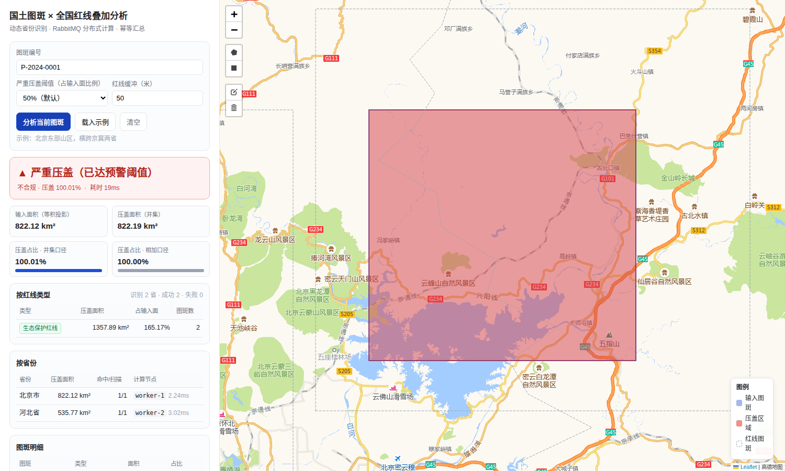
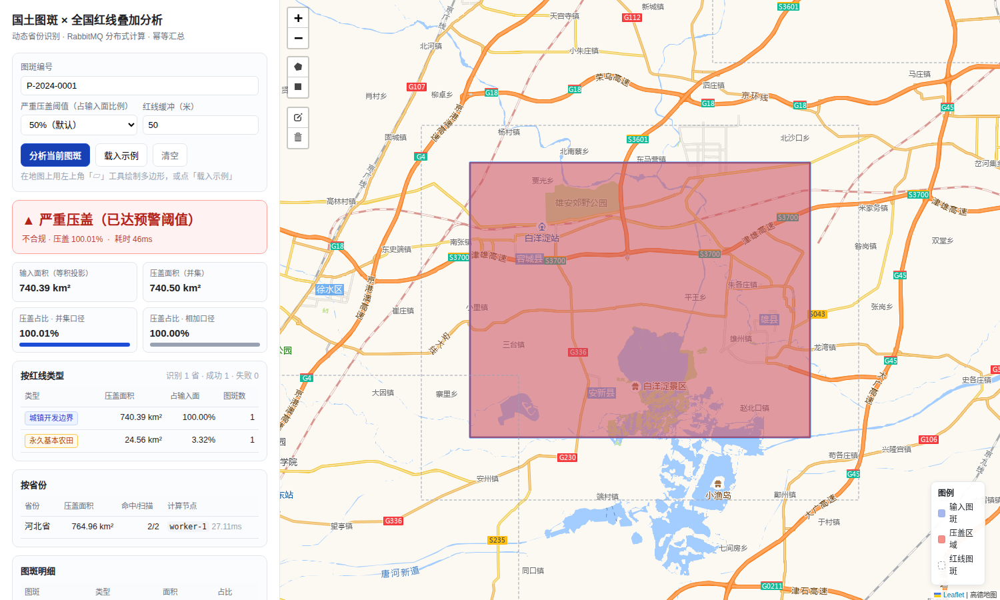
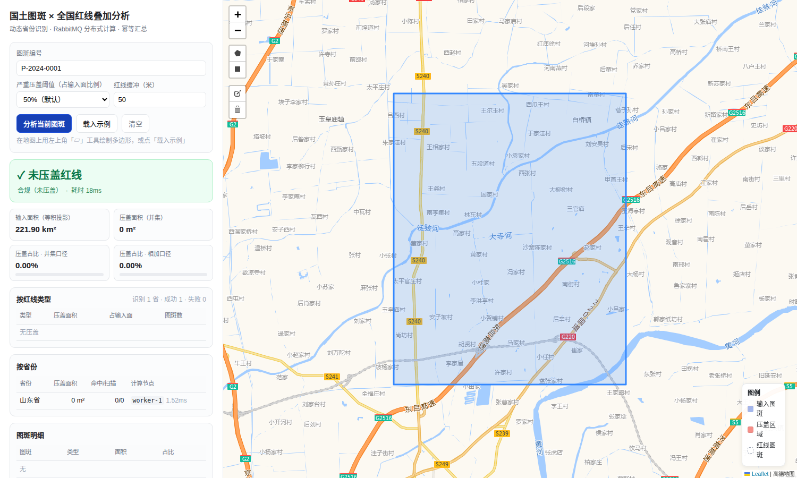

# 国土图斑 × 全国红线叠加分析

基于《红线叠加分析技术方案（分布式版）》的可运行实现：**输入区域面 → 动态识别涉及省份 → RabbitMQ 按省拆分子任务 → GDAL/OGR 空间相交 → 幂等汇总 → 合规结论 + 地图渲染**。

仓库里有两套代码，按用途选：

| 目录 | 内容 | 适用场景 |
|---|---|---|
| `core/` | 4 个核心 py + `quickstart.py`，无 MQ、无 Web，单机串行 | 验证算法、调试数据、参考实现 |
| `app/` + `web/` | 完整工程：FastAPI 主节点 + RabbitMQ + 计算节点 + Leaflet 前端 | 联调、压测、上生产前验证 |

```bash
# 核心算法（最快路径，秒级出结果）
cd core && ./run_demo.sh

# 完整工程（需要 docker 跑 RabbitMQ）
bash scripts/bootstrap.sh
bash scripts/run_all.sh        # 打开 http://127.0.0.1:8001/
/usr/bin/python3 tests/e2e_test.py
```

> **依赖**：GDAL 的 Python 绑定（`osgeo`）走系统包，必须用**系统 Python**（`/usr/bin/python3`）：
> `apt install gdal-bin python3-gdal`。venv/conda 的 Python 读不到这套绑定。

| 严重压盖（跨省示例） | 多类型压盖（雄安） | 未压盖（山东） |
|---|---|---|
|  |  |  |

| 端口 | 服务 |
|---|---|
| 8001 | 主节点 API + 前端页面 |
| 5672 | RabbitMQ（docker） |

## 1. 架构

```
             ┌──────────────────────────────────────────────┐
  前端地图    │  main.py  (FastAPI 主节点)                    │
  (Leaflet)  │  ├─ 坐标统一 → CGCS2000 / EPSG:4490           │
   ──POST──▶ │  ├─ 省份识别（bbox 预筛 + 包围盒精确相交）      │
             │  ├─ 动态拆 N 个子任务 → RabbitMQ fanout       │
             │  └─ 汇总（幂等合并）+ 合规判定                 │
             └───────────────┬──────────────────────────────┘
                             │  redline.task.{worker_id}
              ┌──────────────┴──────────────┐
        ┌─────▼─────┐                 ┌─────▼─────┐
        │ worker-1  │      ...        │ worker-N  │   每个 worker 一个独占队列
        │ OGR 相交  │                 │ OGR 相交  │   prefetch=1，天然负载均衡
        └─────┬─────┘                 └─────┬─────┘
              │  redline.result                 │
              └───────────────┬─────────────────┘
                              ▼
                     主节点结果聚合（batch_id + task_id 去重）
```

为什么用 **fanout 到独占队列** 而不是一个共享队列：一条消息只能被一个消费者拿到。按省拆的任务要分给不同节点，就必须「每个节点一份」，否则一个节点的结果会顶掉另一个节点的结果。见 `app/topology.py`。

## 2. 相对原方案的修正（重要）

原方案有 6 处会导致**错误结论**或**跑不起来**的问题，实现时已修正：

| # | 原方案 | 问题 | 本实现 |
|---|---|---|---|
| 1 | `overlap_ratio = S_overlap / S_original` | 跨省时各省面积相加会 **>100%**；且没考虑**红线之间互相重叠**（生态红线与永久基本农田可叠在同一地块） | `S_original` = **输入面自身面积**（椭球面积，只算一次）；同时输出 `sum_overlap_area`、`ratio_of_original`（封顶 100%）与 `union_overlap_area`、`ratio_union`（先 union 再算，用于「严重压盖」判定） |
| 2 | `GetArea()` 直接算 | 在 EPSG:4490（度）下得到的是**平方度**，不是平方米；用 Web 墨卡托则高纬误差可达数倍 | 统一 `osr` 投影到 **Albers 等积（EPSG:9822 / 以区域中心自定义）** 计算面积，同时用 GDAL 椭球公式（`OGR_GEOM_AREA_ELLIPSOID`）交叉校验 |
| 3 | Shapefile 存全国红线 | `.shp` 单文件 2GB 上限、字段名 10 字符、无空间索引时遍历全省 | GeoPackage / FlatGeobuf（自带 R 树索引），`SetSpatialFilter(bbox)` 先粗筛，再精算 |
| 4 | 只按 bbox 判断省份 | bbox 跨省但实际面只在其中一个省，会多拆任务；反之边界处会漏 | bbox 预筛 → **省份包围盒 + 实际几何 `Intersects`** 双重判断 |
| 5 | 消息体只带图斑 ID | 计算节点拿不到**输入面几何**，无法相交 | 消息体带 `batch_id / task_id / province_code / input_wkt / params`，几何走 WKT 传（也可换成对象存储 key） |
| 6 | 「必要时缓冲」 | 红线数据在省界被裁剪，压盖区域正好骑在省界上时两边各算一半，容易漏 | 计算时对红线**按 `buffer_m` 外扩**（默认 50m，可配），汇总时再对重叠结果做 union 去重 |

另外补充原方案缺的两件事：
- **幂等与容错**：每个子任务 `task_id` 唯一，主节点按批次去重；worker 失败消息进死信队列；同一批次可重投。
- **超时兜底**：`wait_timeout` 到期即返回「部分结果」，前端能看到哪些省还没回来，而不是挂死。

## 3. 目录结构

```
core/                核心算法（单机版，无 MQ 依赖）
  geo.py             坐标统一 / 等积面积 / 缓冲
  province.py        动态省份识别
  overlay.py         相交计算
  redline_index.py   GPKG + R 树 数据访问
  quickstart.py      单文件入口
app/
  config.py         配置（数据目录、RabbitMQ、阈值、缓冲距离）
  geo.py            坐标统一 / 面积计算 / 几何工具
  province.py       动态省份识别
  redline_index.py  红线数据访问（OGR + 空间索引）
  overlay.py        相交计算核心
  topology.py       MQ 拓扑（fanout + 独占队列、死信）
  publisher.py      任务分发 + 结果回传
  worker.py         计算节点
  aggregator.py     结果汇总 + 合规判定（幂等）
  main.py           主节点 API + 静态页
web/index.html      前端（Leaflet 画框 + 结果表格 + 压盖渲染）
scripts/
  bootstrap.sh      环境初始化
  gen_data.py       生成演示红线数据（北京/河北真实边界侧区域）
  build_index.py    构建空间索引、省份边界包
  e2e_test.py       端到端用例（跨省/省内/压盖/不压盖）
docs/
  需求分析与方案评审.md
```

## 4. 数据契约

全国红线数据集按省一个图层（或一个文件），字段固定：

| 字段 | 类型 | 说明 |
|---|---|---|
| `fid` | string | 图斑唯一标识 |
| `type` | string | 红线类型：`生态保护红线` / `永久基本农田` / `城镇开发边界` |
| `province` | string | 省级行政区名称 |
| `geometry` | Polygon/MultiPolygon | CGCS2000 经纬度 |

当前演示数据目录：`data/redline/{省名}.gpkg`。

## 5. API

`POST /api/v1/overlay/analyze`

```json
{
  "feature_id": "P-2024-0001",
  "geometry": {"type": "Polygon", "coordinates": [[[116.2,39.0],[116.9,39.0],[116.9,39.6],[116.2,39.6],[116.2,39.0]]]},
  "geometry_srid": 4326,
  "severe_ratio": 0.5,
  "buffer_m": 50,
  "wait_timeout": 30
}
```

返回：见 `docs/需求分析与方案评审.md` 的「输出样例」。

`GET /api/v1/overlay/jobs/{batch_id}` 查批次全量结果；`GET /healthz` 探活；`GET /api/v1/provinces` 省份列表。

## 6. 验证

```bash
/usr/bin/python3 tests/e2e_test.py
```

覆盖：单省压盖、跨省压盖、完全不压盖、几何跨省但实际只在一个省（不应多拆任务）、大面覆盖多省、坐标错误输入。

## 7. 生产化还需补的

演示跑得通 ≠ 能上生产，这几块是刻意没做的：

1. **RabbitMQ 高可用**：镜像队列 / Quorum 队列 + 集群。
2. **结果持久化**：现在在内存（带 TTL）。生产应写 PG + `batch_id/task_id` 唯一索引，天然幂等。
3. **对象存储**：几何用 WKT 直传只适合小面（大面 WKT 可能几 MB）。生产走 OSS/MinIO 传 `key`。
4. **National 数据**：`data/province/` 用的是简化后的省级边界（约 1km 精度），**不能直接用于合规判定**。生产必须替换为自然资源部门下发的标准行政区划（含省界争议处理）。
5. **红线数据时效**：需建置数据版本号，分析结果要记录用了哪一版红线（合规结论要可追溯）。
